<div align="center">

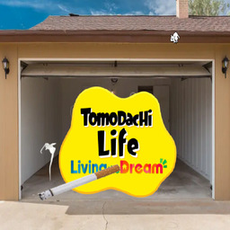

# TomoToolNX

**A full Tomodachi Life save editor that runs on the Switch itself.**

No PC, no save manager, no sending your save anywhere. Edit it from the couch
with a controller, or from your phone's browser over WiFi.

[](https://github.com/miiazertyy/TomoToolNX/releases/latest)
[](https://github.com/miiazertyy/TomoToolNX/releases)
[](https://github.com/miiazertyy/TomoToolNX/actions/workflows/build.yml)
[](LICENSE)


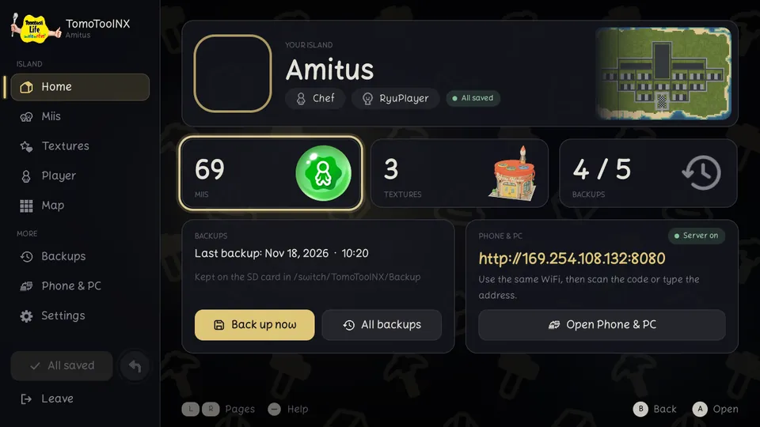

</div>

---

> [!NOTE]
> Needs a Switch that can run homebrew. Your save is copied to the SD card before anything is written, and every texture import keeps its own backup, so you can always get back to where you started.

> [!TIP]
> Stuck, or want something added? [Open an issue](https://github.com/miiazertyy/TomoToolNX/issues/new). There are no dumb questions.

**New in 2.0:** a whole new interface, dressed in the game's own art. Everything
lives in a sidebar, you move one highlight to whatever you want and press A,
every press, switch and page has its own sound and animation, each place plays
the game's own music, and **−** tells you what each button does on the screen
you are on. Plus updates that install
themselves, backups one press away with what each one holds, every Mii or
texture at once with **Y**, seven themes, a browser editor with the same look,
and a stack of fixes, including the face paint that got overwritten when
importing into a blank Mii. The full list is in the [changelog](CHANGELOG.md).

---

## What it does

| | |
|---|---|
| **Miis** | Every Mii drawn as the game draws it, face paint included. Profile, personality, words, relationships, items, habits, house and the whole social web. Import and export individual Miis as `.ltd` files. **Y** shows every Mii at once |
| **Textures** | Every UGC texture as a thumbnail grid. Drop a PNG, JPEG or WebP over any of them (face paint, food, goods, house exteriors...). Resized, alpha cleaned and re-encoded for you |
| **Background removal** | Cuts the subject out of your PNG **on the console**, with a neural net running on the Switch itself. No website, no upload |
| **Island generator** | Build a whole island from a template, or let it surprise you. Classic, archipelago, snowy and cherry blossom |
| **Map** | Your island from above over the whole tab, in the game's square tiles with every object's picture. Reach in with your hand to pick objects up, carry them and put them down, turn them, relink them or change who lives in them. Place and remove objects, paint the floor, undo, save it as a PNG |
| **TomodachiShare** | Browse the online catalogue, search, preview, and download shared Miis straight into a save slot |
| **Player save** | Name, island, money, currency, birthday, region, languages, wishes, fountain, island size and the rest |
| **Backups** | Offered every time you open a user, and one press away on Home. A timeline of every backup with its age, size and what is inside; restore one without leaving the editor |
| **Updates** | Shows what is new and installs the new version itself, checked against GitHub's SHA-256 before it replaces anything |
| **MTP over USB** | Turn on USB file transfer on the Phone & PC page and the SD card shows up on your computer, via [libhaze](https://github.com/ITotalJustice/libhaze) |
| **Themes** | Classic gold (the default), Midnight, Dark pastel, Moss, Ember, Sakura and Slate, the same on the console and in the browser, with your own accent and background colours on top, and the game's patterns drifting behind each page |
| **Sounds** | Every press, switch, slider and page makes Tomodachi Life's own sound for it, or the classic ones made with the sound design of [LLM-Selfbot](https://github.com/miiazertyy/LLM-Selfbot). Turn them down or off in Settings |
| **Music** | Each place plays the game's own music for it (the island by day or by night, the Mii editor, the texture editor, island editing...). It comes with the app, so it plays on any console or emulator, and the game's takes blend into each other in step. In the browser too. Off, quieter or one piece everywhere in Settings |
| **Seven languages** | English, French, Spanish, German, Japanese, Russian and Chinese, in both interfaces |

---

## Two ways to use it

<table>
<tr>
<td width="50%">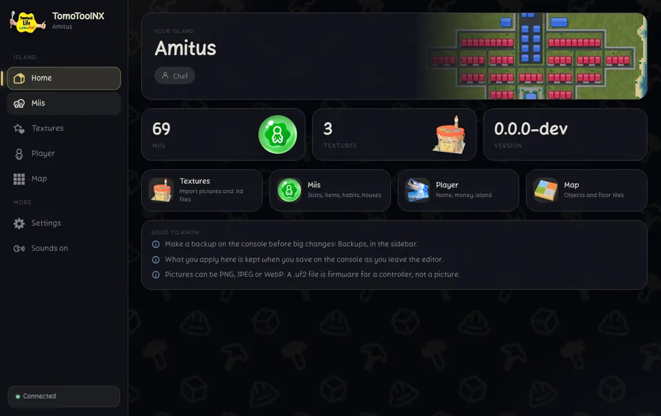</td>
<td width="50%">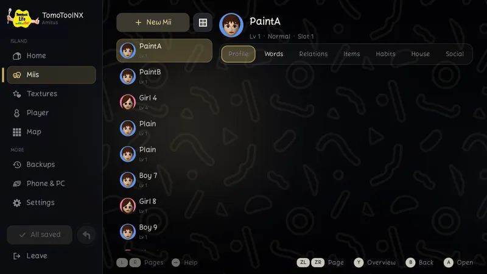</td>
</tr>
<tr>
<td valign="top">

**WebUI**

Starts a small server on the console. Point any browser on the same
network at it, or just scan the QR code on the Phone & PC page.

Nicer for long sessions, a real keyboard, and dragging things around
the map. Same sidebar as the console; on a phone it becomes a bar at the
bottom of the screen.

</td>
<td valign="top">

**On-Switch**

The whole editor with a controller or the touchscreen. Nothing else
needed, nothing else on the network.

Move the highlight to anything and press **A**. **B** goes back,
**L / R** jump between places in the sidebar, and the bar along the
bottom only ever lists buttons that do something right now.

</td>
</tr>
</table>

<details>
<summary><b>More of it</b></summary>

<br>

<table>
<tr>
<td width="50%">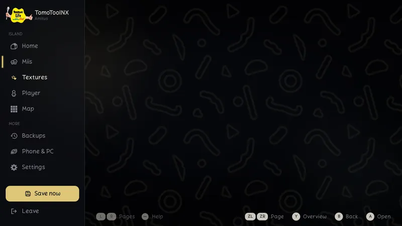</td>
<td width="50%">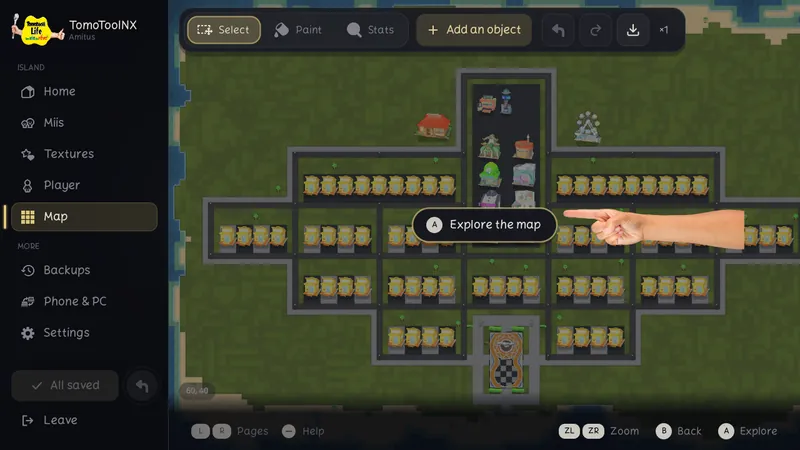</td>
</tr>
<tr>
<td width="50%">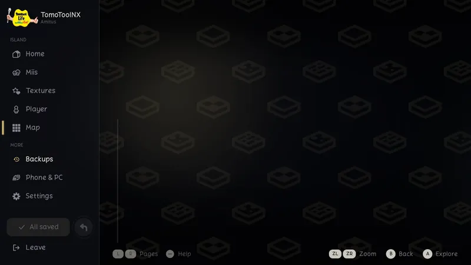</td>
<td width="50%">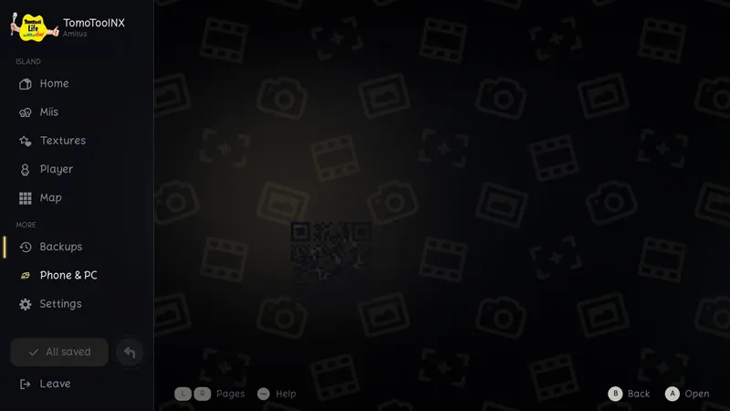</td>
</tr>
<tr>
<td width="50%">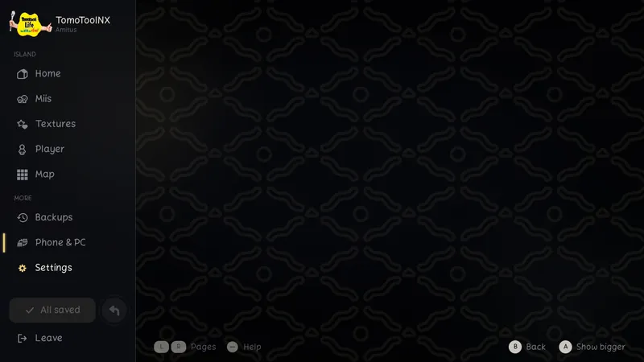</td>
<td width="50%">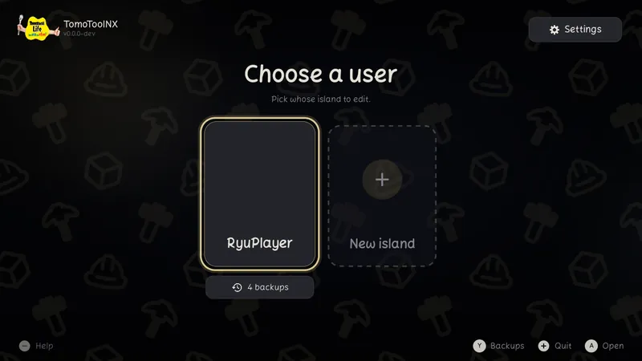</td>
</tr>
<tr>
<td colspan="2" align="center">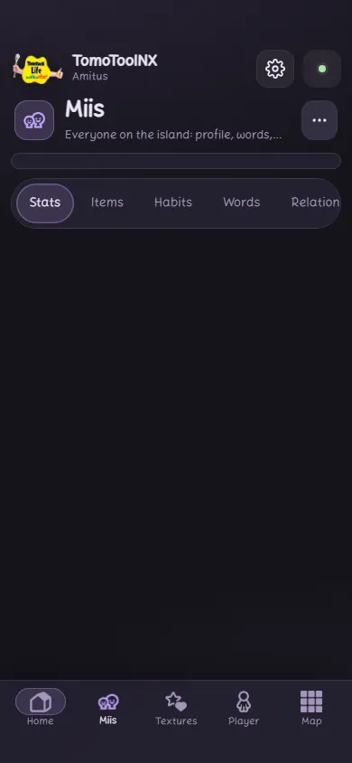</td>
</tr>
</table>

</details>

---

## Controls

The same everywhere on the console. Press **−** on any screen to see this
list for the place you are in.

| Button | Does |
|---|---|
| D-pad / left stick | Move the highlight |
| **A** | Press what is highlighted; on a value, open the keyboard or the list |
| **◀ ▶** on a value | Change it |
| **B** | Back: closes a sheet or dialog, then goes out to the sidebar, then asks before leaving the island. It never throws away your changes |
| **L / R** | Previous / next place in the sidebar (or section in Settings) |
| **X** | Undo the change on the highlighted row, when there is one |
| **Y** | Every Mii or texture at once, to pick one. On the first screen: the highlighted user's backups |
| **ZL / ZR** | Previous / next tab of a Mii; zoom on the Map, around your hand |
| **A** on the Map | Explore it. The stick moves your hand (the D-pad a tile at a time); **A** picks up the object under it and puts it down, **X** turns it, **Y** jumps to the next object, **B** puts it back, then stops exploring |
| Right stick | Scroll |
| **−** | What every button does here |
| **+** | Leave the island (it asks: save and leave, leave without saving, or stay). On the first screens: quit |
| Touch | Tap to press, drag to scroll |

**Save now** at the bottom of the sidebar writes your changes without leaving. The round button beside it undoes
the last change; hold it to undo everything since the last save.

---

## Install

1. Download `TomoToolNX.nro` from the [latest release](https://github.com/miiazertyy/TomoToolNX/releases/latest)
2. Put it in `/switch/TomoToolNX/` on your SD card
3. Launch it from the homebrew menu

When a newer version is out, it shows what is new and installs it for you:
**Update now** downloads it and checks it, and it takes its place when you close
the app (or straight away with **Restart now**).

**Then:** pick a user account, back up (or skip), and you land on Home. The
sidebar has everything else: Miis, Textures, Player and Map, then Backups,
Phone & PC (the address and QR code for your browser) and Settings.

---

## Working with textures

PNG, JPEG and WebP pictures are resized to the target format automatically,
and the encoder is sRGB aware so colours come out matching the game rather
than washed out.

A transparent background with clean edges gives the best result, which is what
**Remove background** is for: it runs [U^2-Net](https://github.com/xuebinqin/U-2-Net)
directly on the console to cut out the subject, so you can take a photo and
import it without touching a PC.

<details>
<summary><b>Custom house exteriors</b></summary>

<br>

House exteriors are textures like any other: on Textures, pick the
**Exterior** chip, open the slot, and import your picture. The texture is laid
over the house's shape, so the easiest way to make your own is to **export the
slot's current design as a PNG** (it shows where everything goes), paint over
it, and import it with **Fit: Stretch**. A design made for another canvas
shape (book, TV) can be fitted with **Canvas shape** in Settings, Pictures (in
the browser, under the gear button).

Designs shared as the game's own files (`.ugctex.zs`, `.canvas.zs` and
`_Thumb.ugctex.zs`, often zipped) import as they are: pick the `.zip` or one of
the files in Replace, From the SD card (or drop them in the browser). The app
checks the design is for the same kind of item and size.

Designs shared as **`.uf2`** files are not pictures. A `.uf2` is firmware for a
Raspberry Pi Pico which, plugged into the Switch, pretends to be a controller
and draws the design in the game by pressing buttons. There is no image inside
to import; look for the PNG or JPEG of the same design instead. TomoToolNX
tells you this if you pick one.

</details>

<details>
<summary><b>Encoder settings</b></summary>

<br>

The default Custom encoder is a faithful port of
[ltd-save-editor](https://github.com/alexislours/ltd-save-editor)'s BC1/BC3
encoder, which is the one that matches the game most closely.
[rgbcx](https://github.com/richgel999/bc7enc_rdo) is there too, as in
ltd-save-editor, and a faster PCA fallback for importing a lot at once. The
import sheet shows what each one does to your picture before it goes in.

</details>

---

## Credits

This stands on other people's work, and the save format in particular took a lot
of people a long time to understand.

| | |
|---|---|
| [LivinTheDreamToolkit](https://gamebanana.com/tools/22435) | by the UGC editor contributors, the tool this follows from |
| [ShareMii](https://github.com/Star-F0rce/ShareMii) | by Star-F0rce, what Mii sharing is based on |
| [alexislours/ltd-save-editor](https://github.com/alexislours/ltd-save-editor) | the save parser, the generated data tables (wishes, habits, clothes, coordinates, treasures), the `Map.sav` schema hashes, the UGC kind table, the housing edit safety rules and the BC1/BC3 encoder. AGPL-3.0-or-later |
| [tlmodding/ltd-gamedata](https://github.com/tlmodding/ltd-gamedata) | early reference for the save key hashes |
| [tlmodding/charinfo-ex](https://github.com/tlmodding/charinfo-ex) | the Mii `CharInfoEx` layout and the game's 100 colours, used for each Mii's hair colour. MIT |
| [aboood40091/ffl](https://github.com/aboood40091/ffl) | the earlier Mii library's face-part placement maths (as decompiled), which real Mii pictures use |
| [ltdimages/images](https://github.com/ltdimages/images) | the item renders the WebUI shows; `tools/assets/build_items.py` makes the console's item pictures and colour dots from them |
| [ITotalJustice/libhaze](https://github.com/ITotalJustice/libhaze) | MTP over USB |
| [richgel999/bc7enc_rdo](https://github.com/richgel999/bc7enc_rdo) | the rgbcx BC1 encoder (`libs/rgbcx`), by Richard Geldreich, Jr. Public domain or MIT |
| [K0lb3/texture2ddecoder](https://github.com/K0lb3/texture2ddecoder) | the ASTC decoder (`libs/astcdec`, with [Maratyszcza/FP16](https://github.com/Maratyszcza/FP16)) that reads the game's Mii face parts when a Mii parts pack is made. MIT |
| [Wikimedia Commons](https://commons.wikimedia.org) and [Openverse](https://openverse.org) | the openly licensed pictures Find a picture online searches; each picture keeps its own licence |

---

## Translating it

Both interfaces are translatable and you do not need to know C++ for either.
Untranslated keys fall back to English, so a partial translation is genuinely
useful. Open a [pull request](https://github.com/miiazertyy/TomoToolNX/compare)
with whatever you touched.

`python tools/check_i18n.py` lists, for both interfaces, the keys each language
has not translated yet, and any key the code uses that English is missing.

<details>
<summary><b>The WebUI</b></summary>

<br>

Every string lives in one JavaScript block at the top of
[`data/webui.html`](data/webui.html). Search for `── Translations ──`.

1. Add your locale to `LOCALE_META`:

   ```js
   const LOCALE_META = [
     {code:'en', label:'English'},
     {code:'fr', label:'Français'},
     {code:'es', label:'Español'},    // your new language
   ];
   ```

2. Copy the whole `en: { ... }` block in `LOCALES`, rename the key, and
   translate the values:

   ```js
   es: {
     'tab.textures':'texturas',
     'tab.mii':'mii',
     'tab.player':'jugador',
     // as many keys as you want, missing ones fall back to English
   },
   ```

The page shows whatever language the console is set to, so to see your work
without a Switch, serve it from your computer:

```sh
python tools/webui_dev_server.py --locale es    # then open http://127.0.0.1:8000
```

</details>

<details>
<summary><b>The on-Switch UI</b></summary>

<br>

Plain `key=value` files in [`romfs/lang/`](romfs/lang/).

1. Copy [`romfs/lang/en.txt`](romfs/lang/en.txt) to `romfs/lang/<code>.txt`
2. Translate the right side of each `=`. Leave the keys and the `#` comments alone
3. Add one line to `kAvailable` in [`source/i18n.cpp`](source/i18n.cpp):

   ```cpp
   const std::vector<Lang::Entry> kAvailable = {
       {"en", "English"},
       {"fr", "Français"},
       {"es", "Español"},               // your new language
   };
   ```

4. Rebuild the `.nro`

It then appears under **Settings, Language**, remembered in `config.ini`.

</details>

---

## Building it

<details>
<summary><b>From source</b></summary>

<br>

You need [MSYS2](https://www.msys2.org/) on Windows, and
[devkitPro](https://devkitpro.org/wiki/Getting_Started) with `devkitA64` and
`libnx`.

Inside the MSYS2 devkitPro shell:

```sh
dkp-pacman -S switch-sdl2 switch-sdl2_image switch-sdl2_ttf switch-libwebp \
             switch-freetype switch-harfbuzz switch-zstd \
             switch-curl switch-mbedtls \
             switch-libopus switch-opusfile switch-libogg
```

The build also calls the `zstd` command line tool to pack the seed saves
(`pacman -S zstd` in MSYS2, `apt install zstd` on Linux).

The app mixes its own sound: the interface sounds are banks in
[`romfs/sfx/`](romfs/sfx/), and the music is Opus, read with libopusfile. To
render the classic bank again, run `node tools/sounds/render_sounds.mjs` (it
needs Node 22 or later and Chrome or Edge).

Then:

```sh
make setup   # once after cloning: fetches libhaze into libs/libhaze/ (skipped if it is already there)
make
```

Out comes `TomoToolNX.nro`. Every build after the first is just `make`.

</details>

<details>
<summary><b>On GitHub</b></summary>

<br>

[`.github/workflows/build.yml`](.github/workflows/build.yml) builds the `.nro`
in the `devkitpro/devkita64` container on every push and pull request, and
uploads it as an artifact of the run.

The version comes from the git tag, never from a file: pushing a tag such as
`2.0.0` builds the `.nro` as version 2.0.0 and **publishes** a release with it
attached, which the in-app updater picks up straight away. Any other build
calls itself `0.0.0-dev`; those see new versions but never install over
themselves. Locally, `make` takes the version from a clean checkout of a tag,
or from `make APP_VERSION=2.0.0`.

To release a version:

```sh
git tag -a 2.0.1 -m "Fixed the map's zoom"   # the message is what the app shows as what's new
git push origin 2.0.1
```

A plain `git tag 2.0.1` works too (GitHub then writes the notes), and so does
publishing a release with a new tag on GitHub's website, as long as you don't
attach a `.nro` yourself: the workflow attaches the one it built. Before
publishing, it checks that the app inside says the tag's version, then reads
the release back the way the updater does.

</details>

<details>
<summary><b>Working on the WebUI</b></summary>

<br>

The WebUI is one file, [`data/webui.html`](data/webui.html), built into the
`.nro`. To work on it without rebuilding and copying after every change:

```sh
python tools/webui_dev_server.py                            # mock data from the seed saves
python tools/webui_dev_server.py --console 192.168.1.20:8080  # the real save on a console
```

The page is read from disk on every request, so save and reload. With
`--console`, the console must be on the editor with its server running.

</details>

<details>
<summary><b>The game's art, and the clips in this README</b></summary>

<br>

The pictures in [`romfs/gfx/`](romfs/gfx/) (patterns, icons, faces, hands, the
news studio) are cut from Tomodachi Life's own files by
`python tools/assets/build_gfx.py <folder of the game's art>`. The app draws
its own icons wherever one of them is missing, so it builds without them.

The rest of what the app carries of the game is made from your own dump the
same way, each by its script: the music in [`romfs/music/`](romfs/music/)
(`tools/assets/build_music.py`), the game's sounds in `romfs/sfx/game.bank`
(`tools/sounds/build_game_bank.py`), the 3D models and tables in
[`romfs/game/`](romfs/game/) (`tools/assets/build_game_files.py`), the Mii parts
in [`romfs/miiparts/`](romfs/miiparts/) (`tools/mii/build_pack.py`, see
[`tools/mii/README.md`](tools/mii/README.md)) and the parks seen from above
(`tools/assets/build_map_tops.py`).

The clips are recorded by the app itself. Put
[`tools/media/tour.txt`](tools/media/tour.txt) next to the `.nro`, add
`debug_ui=1` to its `config.ini`, and launch it: it plays the tour and saves
every frame, at a fixed 1/30 s, to `/switch/TomoToolNX/rec/`. Then:

```sh
python tools/media/make_webp.py rec/places .github/media/places.webp
```

</details>

---

<div align="center">

GPL-3.0. Have fun with your island.

</div>
