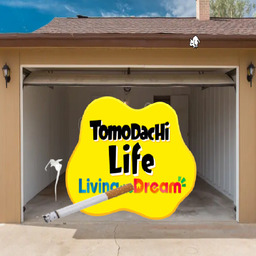

<div align="center">



# TomoToolNX

**A full Tomodachi Life save editor that runs on the Switch itself.**

No PC, no save manager, no sending your save anywhere. Edit it from the couch
with a controller, or from your phone's browser over WiFi.

[](https://github.com/miiazertyy/TomoToolNX/releases/latest)
[](https://github.com/miiazertyy/TomoToolNX/releases)
[](LICENSE)


</div>

---

> [!NOTE]
> Needs a Switch that can run homebrew. Your save is copied to the SD card before anything is written, and every texture import keeps its own backup, so you can always get back to where you started.

> [!TIP]
> Stuck, or want something added? [Open an issue](https://github.com/miiazertyy/TomoToolNX/issues/new). There are no dumb questions.

---

## What it does

| | |
|---|---|
| **Miis** | Stats, words, habits, belongings, relationships, housing and the whole social graph. Import and export individual Miis as `.ltd` files |
| **Textures** | Drop a PNG over any UGC texture (FacePaint, Food, Goods, Thumbs). Resized, alpha cleaned and re-encoded for you |
| **Background removal** | Cuts the subject out of your PNG **on the console**, with a neural net running on the Switch itself. No website, no upload |
| **Island generator** | Build a whole island from a template, or let it surprise you. Classic, archipelago, snowy and cherry blossom |
| **Map** | Your island as a 120x80 grid. Click any object to move it, rotate it, relink it or change who lives in it. Place and remove objects |
| **TomodachiShare** | Browse the online catalogue, search, preview, and download shared Miis straight into a save slot |
| **Player save** | Name, island, money, currency, birthday, region, languages, wishes, fountain, island size and the rest |
| **Backups** | Automatic before every edit, restorable from inside the app |
| **MTP over USB** | The SD card mounts as a USB drive while the WebUI is running, via [libhaze](https://github.com/ITotalJustice/libhaze) |
| **Seven languages** | English, French, Spanish, German, Japanese, Russian and Chinese, in both interfaces |

---

## Two ways to use it

<table>
<tr>
<td width="50%"></td>
<td width="50%"></td>
</tr>
<tr>
<td valign="top">

**WebUI**

Starts a small server on the console. Point any browser on the same
network at it, or just scan the QR code the app puts on screen.

Nicer for long sessions, a real keyboard, and dragging things around
the map. The SD card mounts over USB at the same time.

</td>
<td valign="top">

**On-Switch**

The whole editor with a controller or the touchscreen. Nothing else
needed, nothing else on the network.

**L / R** or **ZL / ZR** switch tabs, each tab lists its own buttons
along the bottom, and **B** backs out of anything.

</td>
</tr>
</table>

---

## Install

1. Download `TomoToolNX.nro` from the [latest release](https://github.com/miiazertyy/TomoToolNX/releases/latest)
2. Put it in `/switch/TomoToolNX/` on your SD card
3. Launch it from the homebrew menu

It tells you when a newer version is out.

**Then:** pick a user account, decide what to do with any existing backup, and
choose WebUI or On-Switch.

---

## Working with textures

PNGs are resized to the target format automatically, and the encoder is sRGB
aware so colours come out matching the game rather than washed out.

A transparent background with clean edges gives the best result, which is what
**remove BG** is for: it runs [U^2-Net](https://github.com/xuebinqin/U-2-Net)
directly on the console to cut out the subject, so you can take a photo and
import it without touching a PC.

<details>
<summary><b>Encoder settings</b></summary>

<br>

The default Custom encoder is a faithful port of
[ltd-save-editor](https://github.com/alexislours/ltd-save-editor)'s BC1/BC3
encoder, which is the one that matches the game most closely. A faster PCA only
fallback is available in the settings if you are importing a lot at once.

</details>

---

## Credits

This stands on other people's work, and the save format in particular took a lot
of people a long time to understand.

| | |
|---|---|
| [LivinTheDreamToolkit](https://gamebanana.com/tools/22435) | by the UGC editor contributors, the tool this follows from |
| [ShareMii](https://github.com/Star-F0rce/ShareMii) | by Star-F0rce, what Mii sharing is based on |
| [alexislours/ltd-save-editor](https://github.com/alexislours/ltd-save-editor) | the save parser, the generated data tables (wishes, habits, clothes, coordinates, treasures), the `Map.sav` schema hashes, the UGC kind table, the housing edit safety rules and the BC1/BC3 encoder. AGPL-3.0-or-later |
| [tlmodding/ltd-gamedata](https://github.com/tlmodding/ltd-gamedata) | early reference for the save key hashes |
| [ITotalJustice/libhaze](https://github.com/ITotalJustice/libhaze) | MTP over USB |

---

## Translating it

Both interfaces are translatable and you do not need to know C++ for either.
Untranslated keys fall back to English, so a partial translation is genuinely
useful. Open a [pull request](https://github.com/miiazertyy/TomoToolNX/compare)
with whatever you touched.

<details>
<summary><b>The WebUI</b></summary>

<br>

Every string lives in one JavaScript block at the top of
[`data/webui.html`](data/webui.html). Search for `── Translations ──`.

1. Add your locale to `LOCALE_META`:

   ```js
   const LOCALE_META = [
     {code:'en', label:'English'},
     {code:'fr', label:'Français'},
     {code:'es', label:'Español'},    // your new language
   ];
   ```

2. Copy the whole `en: { ... }` block in `LOCALES`, rename the key, and
   translate the values:

   ```js
   es: {
     'tab.textures':'texturas',
     'tab.mii':'mii',
     'tab.player':'jugador',
     // as many keys as you want, missing ones fall back to English
   },
   ```

It then appears under **Settings, Language**, remembered per device in
`localStorage`.

</details>

<details>
<summary><b>The on-Switch UI</b></summary>

<br>

Plain `key=value` files in [`romfs/lang/`](romfs/lang/).

1. Copy [`romfs/lang/en.txt`](romfs/lang/en.txt) to `romfs/lang/<code>.txt`
2. Translate the right side of each `=`. Leave the keys and the `#` comments alone
3. Add one line to `kAvailable` in [`source/i18n.cpp`](source/i18n.cpp):

   ```cpp
   const std::vector<Lang::Entry> kAvailable = {
       {"en", "English"},
       {"fr", "Français"},
       {"es", "Español"},               // your new language
   };
   ```

4. Rebuild the `.nro`

It then appears under **Settings, Language**, remembered in `config.ini`.

</details>

---

## Building it

<details>
<summary><b>From source</b></summary>

<br>

You need [MSYS2](https://www.msys2.org/) on Windows, and
[devkitPro](https://devkitpro.org/wiki/Getting_Started) with `devkitA64` and
`libnx`.

Inside the MSYS2 devkitPro shell:

```sh
dkp-pacman -S switch-sdl2 switch-sdl2_image switch-sdl2_ttf switch-sdl2_mixer \
             switch-mpg123 switch-freetype switch-harfbuzz switch-zstd \
             switch-curl switch-mbedtls
```

`dkp-pacman` pulls the transitive dependencies (`libogg`, `libvorbisidec`,
`libopus`, `opusfile`, `libmodplug`, `flac`) in on its own. `switch-sdl2_mixer`
and `switch-mpg123` are there for the click and navigation sounds in the
on-Switch UI.

Then:

```sh
make setup   # once after cloning, fetches libhaze into libs/libhaze/
make
```

Out comes `TomoToolNX.nro`. Every build after the first is just `make`.

</details>

---

<div align="center">

GPL-3.0. Have fun with your island.

</div>
